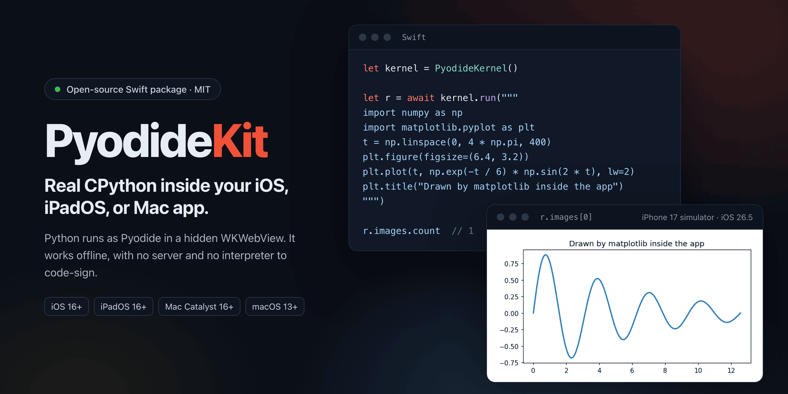
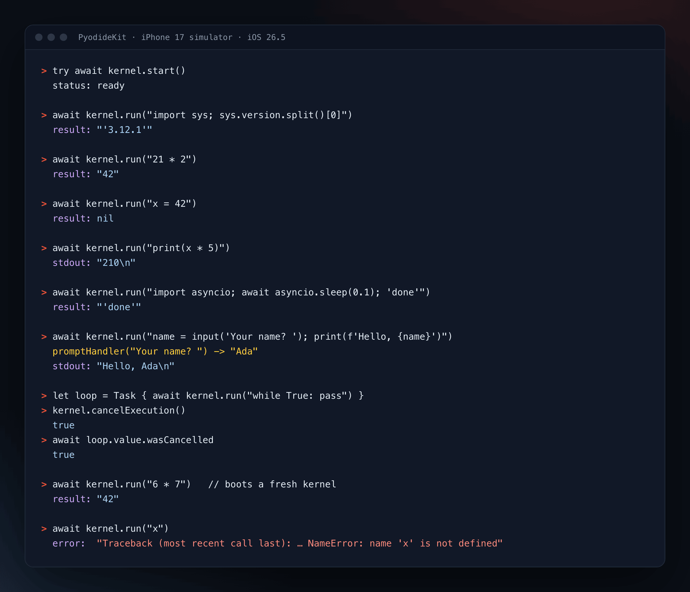
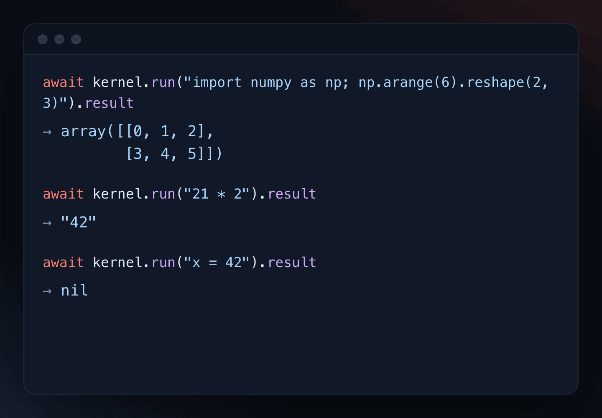
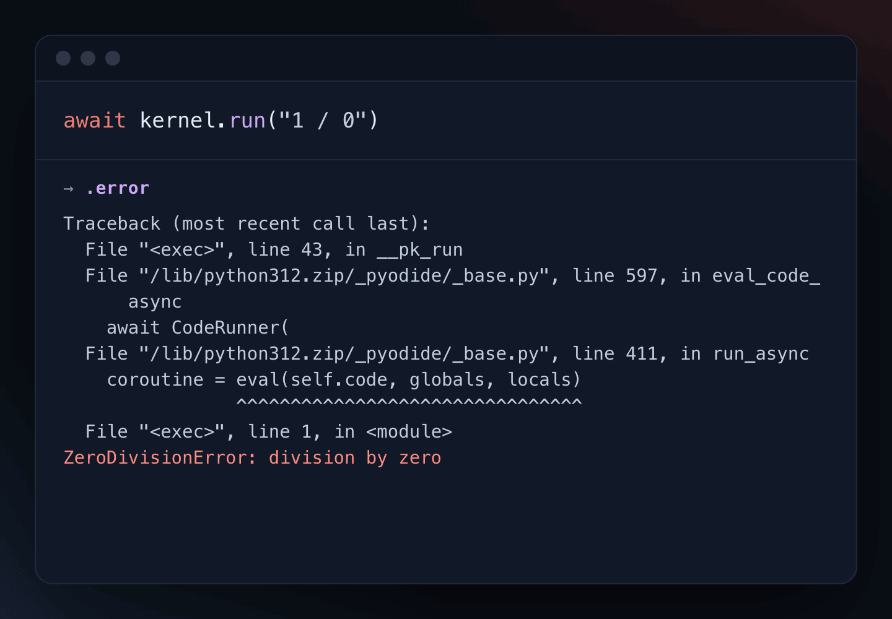
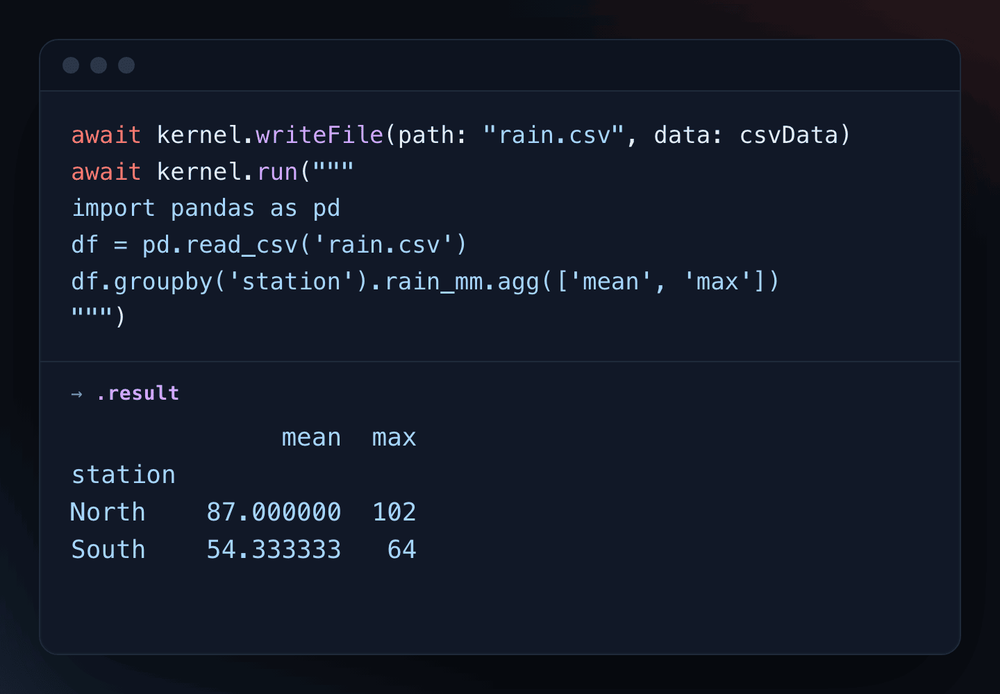
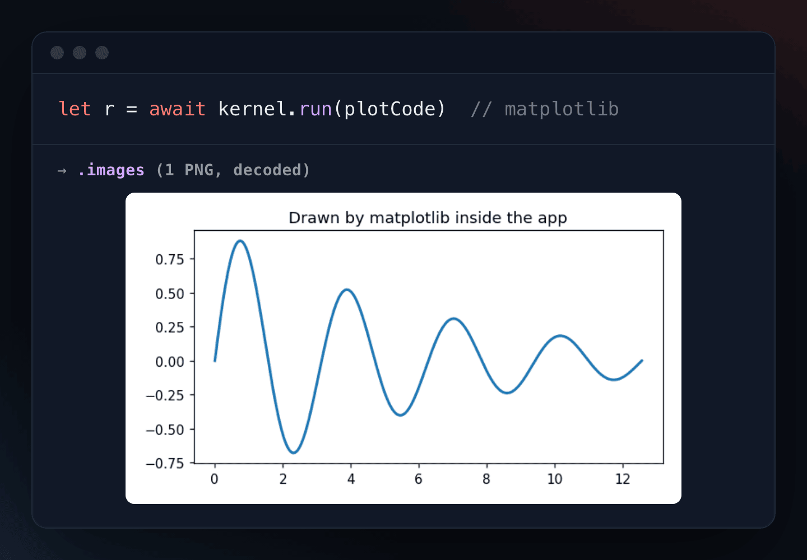
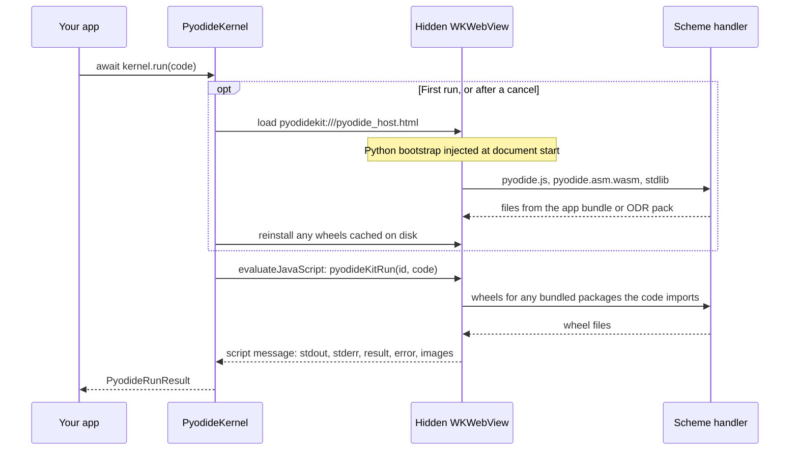

<p align="center">
  
</p>

<p align="center">
  <b>Run real CPython inside an iOS, iPadOS, or Mac app, offline.</b><br>
  PyodideKit runs Pyodide, CPython compiled to WebAssembly, in a hidden <code>WKWebView</code> and gives you a Swift API on top.
</p>

<p align="center">
  <a href="https://github.com/NoelSason/PyodideKit/actions/workflows/ci.yml"></a>
  
  
  
  
  
  
</p>

<p align="center">
  <a href="#see-it-work">Demo</a> ·
  <a href="#what-you-get-back">What you get back</a> ·
  <a href="#how-it-works">How it works</a> ·
  <a href="#install">Install</a> ·
  <a href="#usage">Usage</a> ·
  <a href="#limitations">Limitations</a>
</p>

> [!NOTE]
> PyodideKit has no tagged release yet, so pin it to `main` or to a commit. The Pyodide runtime is not in this repository: [`scripts/fetch-pyodide.sh`](scripts/fetch-pyodide.sh) downloads it from upstream, and you bundle it with your app.

```swift
import PyodideKit

let kernel = PyodideKernel()
let result = await kernel.run("import numpy as np; np.arange(6).reshape(2, 3)")

print(result.result ?? "")
// array([[0, 1, 2],
//        [3, 4, 5]])
```

One kernel is one persistent namespace, like a Jupyter kernel. State carries across `run` calls until you call `restart()`.

## Why

Getting Pyodide to boot on iOS is quick. Keeping it working is the hard part. The [usual advice](https://github.com/pyodide/pyodide/discussions/4764) is to run a local HTTP server and then try to remove it. Removing it is the first of several problems, and each one shows up somewhere different: at boot, at App Store submission, in the background, or in the keyboard.

PyodideKit is the runtime layer from [Lectra](https://www.canvascope.org/products/lectra), an iPad app for Pencil notes, PDFs, and Python notebooks, extracted into a Swift package. It is about 1,000 lines of code. Most of the work went into the problems listed in [How it works](#how-it-works).

## See it work

<p align="center">
  
</p>

<sub>Real output from PyodideKit on the iPhone 17 simulator (iOS 26.5), using the Pyodide 0.26.4 runtime. A small test harness, not part of this repository, made each call and printed the result. Tracebacks are shortened to their last line.</sub>

## What you get back

Every `run` returns a `PyodideRunResult`. It never throws.

<table>
  <tr>
    <td width="50%"></td>
    <td width="50%"></td>
  </tr>
  <tr>
    <td valign="top"><b>1. Results follow Jupyter rules.</b> A trailing expression comes back as its <code>repr</code> in <code>.result</code>. A trailing statement returns <code>nil</code>. Printed text goes to <code>.stdout</code> and <code>.stderr</code>.</td>
    <td valign="top"><b>2. Errors are data.</b> A Python exception comes back as a formatted traceback in <code>.error</code>, because a failing cell is a normal outcome, not a crash.</td>
  </tr>
  <tr>
    <td width="50%"></td>
    <td width="50%"></td>
  </tr>
  <tr>
    <td valign="top"><b>3. Hand Python a file.</b> <code>writeFile</code> puts bytes into the kernel's in-memory file system, where <code>open()</code> and pandas can read them. The CSV here is sample data.</td>
    <td valign="top"><b>4. Figures come back as PNGs.</b> matplotlib draws with the Agg backend, and every open figure returns as a base64 PNG in <code>.images</code>.</td>
  </tr>
</table>

<sub>Rendered from a separate run on the same simulator. The values are copied from the returned <code>PyodideRunResult</code> fields; the figure is the decoded PNG from <code>.images</code>.</sub>

## How it works



`PyodideKernel` loads `pyodidekit:///pyodide_host.html` into a web view that is never shown. A custom URL scheme handler serves the host page from the package, and the runtime files from your app bundle or On-Demand Resource (ODR) pack. Swift sends code with `evaluateJavaScript`, and the result comes back through a script message handler.

### The problems it solves

1. **`file://` can't load Pyodide.** WebKit treats every `file://` origin as opaque, so Pyodide's own `fetch()` of `pyodide.asm.wasm` fails CORS and the boot stops. PyodideKit serves the assets over a custom scheme registered with `WKURLSchemeHandler`. That gives the page a real origin, so the kernel runs offline without a local HTTP server.
2. **Bundled Python source gets your upload rejected.** App Store validation treats a bundled file that contains Python source as an unsigned executable and rejects the upload with **ITMS-90035**. This fails at submission, not at build time. PyodideKit keeps the kernel bootstrap as a Swift string and injects it with a `WKUserScript` at `.atDocumentStart`, so it ships as data.
3. **iOS can kill the kernel without telling you.** The system reclaims the WebContent process under memory pressure, often while the app is in the background. The web view still accepts JavaScript, but no reply ever comes, so an `await` would hang forever. PyodideKit handles `webViewWebContentProcessDidTerminate` and adds a per-run inactivity watchdog as a backstop.
4. **A web view in a window takes your keyboard.** An attached `WKWebView` joins the responder chain and swallows hardware-keyboard modifiers from the text view the user is typing in. The kernel's web view is never added to a window. It still runs JavaScript and WebAssembly, which is all the kernel needs.
5. **`WKError 5` is not a failure.** WebKit reports "JavaScript execution returned a result of an unsupported type" when it can't bridge a script's return value, including the Promise from every `async` function. Treating that as an error throws away runs that succeeded, so PyodideKit ignores it and waits for the real result message.
6. **`pip install` has to survive a relaunch.** micropip resolves the dependency closure at install time and reports it with `freeze()`. PyodideKit copies the downloaded wheels to disk and reinstalls them from the local file system at boot, with dependency resolution off, so the next launch needs no network.

The runtime is about 70 MB with the scientific stack. To keep it out of the initial app download, PyodideKit can load it from an [On-Demand Resource](https://developer.apple.com/documentation/foundation/nsbundleresourcerequest) pack.

### What's in the package

| Path | What it holds |
|---|---|
| [`PyodideKernel.swift`](Sources/PyodideKit/PyodideKernel.swift) | The kernel: boot, `run`, `install`, `writeFile`, cancel, the Python bootstrap, the message bridge, and the scheme handler |
| [`PyodideConfiguration.swift`](Sources/PyodideKit/PyodideConfiguration.swift) | Asset source, URL scheme, wheel cache directory, and inactivity timeout |
| [`PyodideRunResult.swift`](Sources/PyodideKit/PyodideRunResult.swift) | `PyodideRunResult`, `PyodideInstallResult`, and `PyodideError` |
| [`PyodideAssetPack.swift`](Sources/PyodideKit/PyodideAssetPack.swift) | Finds runtime files in the bundle and owns the On-Demand Resource request |
| [`PyodideWheelCache.swift`](Sources/PyodideKit/PyodideWheelCache.swift) | Offline cache of wheels installed with micropip |
| [`BundledAssetServer.swift`](Sources/PyodideKit/BundledAssetServer.swift) | Reads runtime files off the main thread and answers WebKit's scheme tasks |
| [`Resources/pyodide_host.html`](Sources/PyodideKit/Resources/pyodide_host.html) | The page the hidden web view loads |
| [`scripts/fetch-pyodide.sh`](scripts/fetch-pyodide.sh) | Downloads a Pyodide release, checks its SHA-256, and stages the files to bundle |

## Install

Add the package to `Package.swift`, or in Xcode with **File > Add Package Dependencies**:

```swift
.package(url: "https://github.com/NoelSason/PyodideKit.git", branch: "main")
```

Then fetch the runtime. This repository doesn't include it: upstream distributes it, it is large, and a vendored copy would go stale.

```bash
scripts/fetch-pyodide.sh
```

The script downloads Pyodide 0.26.2 by default, checks it against [`scripts/pyodide-checksums.txt`](scripts/pyodide-checksums.txt), and stages a `Runtime/` directory. Drag `Runtime/` into Xcode as a **folder reference** (blue, not yellow) named `Pyodide`. Then confirm it appears in **Build Phases > Copy Bundle Resources**.

To keep your app smaller, stage only the packages you need:

```bash
scripts/fetch-pyodide.sh --packages "numpy,micropip"
```

`--version` and `--out` choose a different Pyodide release and output folder.

## Usage

### Run code

`run` never throws. Python errors come back as data:

```swift
let result = await kernel.run("1 / 0")
result.error      // "Traceback (most recent call last): ... ZeroDivisionError: division by zero"
result.stdout     // ""
```

A trailing expression reports its `repr`. A trailing statement reports nothing:

```swift
await kernel.run("21 * 2").result   // "42"
await kernel.run("x = 42").result   // nil
```

Top-level `await` works:

```swift
await kernel.run("import asyncio; await asyncio.sleep(0.1); 'done'")   // .result is "'done'"
```

### Plots

The kernel sets matplotlib to the Agg backend before matplotlib can try to draw into a page that has no display. Figures come back as base64 PNGs:

```swift
let result = await kernel.run("""
import matplotlib.pyplot as plt
plt.plot([1, 4, 9])
""")

if let png = result.images.first, let data = Data(base64Encoded: png) {
    imageView.image = UIImage(data: data)
}
```

### Hand Python a file

```swift
await kernel.writeFile(path: "data.csv", data: csvData)
let result = await kernel.run("import pandas as pd; pd.read_csv('data.csv').describe()")
```

### Install packages

```swift
let installed = await kernel.install("cowsay")
```

Pure-Python wheels and wheels built for Pyodide's WebAssembly target install. Packages with C extensions that upstream hasn't built don't, and PyodideKit turns micropip's error into a message a user can read.

PyodideKit copies installed wheels to disk and reinstalls them on the next boot without a network.

### `input()`

Python's `input()` calls `promptHandler`, so you can show any UI you like. Pass `nil` to raise `EOFError` in the running code:

```swift
kernel.promptHandler = { prompt, defaultValue, respond in
    presentTextField(message: prompt) { entered in respond(entered) }
}
```

If you don't set a handler, `input()` returns the default value.

### Stop runaway code

Pyodide can't interrupt running CPython: a `while True:` loop never yields back to the JavaScript event loop. The only dependable way to stop it is to discard the page:

```swift
kernel.cancelExecution()
```

Every pending call returns with `wasCancelled == true`. **Discard those results instead of showing them**; they describe the cancellation, not output. The next `run` boots a fresh kernel with an empty namespace. Cancelling the enclosing Swift `Task` does the same thing.

### On-Demand Resources

```swift
let kernel = PyodideKernel(configuration: PyodideConfiguration(
    assetSource: .onDemandResource(tag: "python-runtime")
))

// Explicit use: download with progress.
try await kernel.start(downloadPolicy: .download)

// Passive warming: start only if the pack is already on the device, so opening
// a .py file never starts a 70 MB download the user didn't ask for.
try await kernel.start(downloadPolicy: .useIfPresent)
```

To show a progress bar, observe `kernel.downloadProgress`.

> [!WARNING]
> While a device is attached to the debugger, Xcode serves On-Demand Resource packs from a local server. That server disappears when you unplug, and every Python run then fails with a connection error that doesn't point at the cause. For Debug builds, turn on **Embed Asset Packs In Product Bundle**.

### Configuration

```swift
PyodideConfiguration(
    assetBundle: .main,
    assetSource: .bundled(subdirectory: "Pyodide"),
    scheme: "pyodidekit",          // must be unique to your app
    wheelCacheDirectory: nil,      // defaults to Application Support/PyodideKit/wheels
    runInactivityTimeout: 180      // seconds a run can go without a reply
)
```

If you register another custom scheme, or run more than one kernel from different asset sets, change `scheme`.

## Requirements

- iOS 16, iPadOS 16, Mac Catalyst 16, or macOS 13 and later
- Swift 5.9 or later

macOS has no On-Demand Resources, so `.onDemandResource` falls back to a plain bundle lookup there.

## Performance

No benchmarks are published here, because none have been run carefully enough to quote. Two patterns are worth knowing before you design around the kernel:

- **Boot and first imports cost the most.** Starting the WebAssembly kernel costs far more than running code in it, and the first import of a large package like pandas is expensive again.
- **A warm kernel is cheap.** Running small snippets in a kernel that is already up is not where the time goes.

Start the kernel before the user needs it, and keep one alive instead of creating one per run. `start()` is safe to call early and more than once; concurrent callers share a single boot.

Contributions of real measurements are welcome.

## Limitations

- **No threads, subprocesses, or sockets.** This is WebAssembly in a browser engine. `requests` doesn't work; use `pyodide.http` or do networking in Swift.
- **Only Pyodide-compatible wheels.** Pure-Python packages always work. Packages with C extensions work only if upstream built them for the WebAssembly target.
- **Memory is bounded by the WebContent process.** A large DataFrame can get the process reclaimed.
- **Not a security boundary against the host app.** The WebAssembly sandbox is a real boundary for the Python code, but treat untrusted input with the same care you would anywhere else.

## Testing

```bash
swift test
```

The 6 unit tests run anywhere, including CI. The 8 end-to-end kernel tests skip unless the Pyodide runtime is staged into a bundle; to exercise them, run them from an app target that bundles the runtime.

## Where it came from

Every problem in [How it works](#how-it-works) came up while building [Lectra](https://www.canvascope.org/products/lectra), an iPad app for Pencil notes, PDFs, and Python notebooks that is [on the App Store](https://apps.apple.com/us/app/lectra-notes/id6759754531). Lectra runs pandas and matplotlib on the device, often with no connection, so it needed Python that works offline, passes App Store review, and survives being backgrounded.

The runtime layer wasn't specific to Lectra, and there was no Swift package for it, so it became this one. Noel Sason wrote and maintains it.

## License

MIT. See [LICENSE](LICENSE).

This repository does not redistribute Pyodide or the Python packages it loads, and they carry their own licenses. See [THIRD_PARTY_NOTICES.md](THIRD_PARTY_NOTICES.md).

PyodideKit is an independent wrapper and is not affiliated with the Pyodide project.
